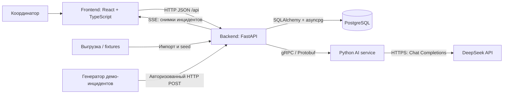
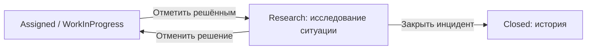

# MTS Incident Command

Проект команды **PROpali-chelipesiki** для кейса МТС на хакатоне Cybergarden.
Рабочее место координатора: контроль инцидентов и SLA, маршрутизация в команды,
ИИ-рекомендации, исследование причин и история закрытий.

## Содержание

- [Быстрый запуск](#быстрый-запуск)
- [Настройки окружения](#настройки-окружения)
- [Назначение](#назначение)
- [Общая схема](#общая-схема)
- [Технологический стек](#технологический-стек)
- [Структура репозитория](#структура-репозитория)
- [Frontend](#frontend)
- [Backend и данные](#backend-и-данные)
- [Жизненный цикл](#жизненный-цикл)
- [Обновление данных в браузере](#обновление-данных-в-браузере)
- [ИИ-подсистема](#ии-подсистема)
- [Авторизация](#авторизация)
- [Основные HTTP-маршруты](#основные-http-маршруты)
- [Развёртывание и границы MVP](#развёртывание-и-границы-mvp)
- [Проверки](#проверки)
- [Команды разработчика](#команды-разработчика)
- [Подробная документация](#подробная-документация)
- [Деплой на VPS](#деплой-на-vps-ubuntu-docker-compose-и-домен)

## Быстрый запуск

Нужны Docker и Docker Compose. Команды выполняются из корня репозитория.

```bash
cp .env.example .env
```

Укажите в `.env` пароль PostgreSQL и случайный `SECRET_KEY` вместо примеров.
Для работы ИИ добавьте `DEEPSEEK_API_KEY`. Настройки окружения описаны ниже.

```bash
docker compose up -d --build
docker compose ps
```

| Адрес | Назначение |
| --- | --- |
| http://localhost:5173 | Интерфейс координатора |
| http://localhost:8000/docs | Swagger UI |
| http://localhost:8000/openapi.json | Схема OpenAPI |
| http://localhost:8000/health | Проверка процесса API |

При старте backend применяет миграции Alembic и добавляет отсутствующие
начальные записи и аккаунты. Существующие рабочие инциденты и пароли сохраняются.
Начальные логины: `admin`, `coordinator`, `engineer1`, `engineer2`, `observer`;
в текущем MVP все эти аккаунты имеют роль координатора. Пароли передаются
отдельно: в репозитории хранятся только хеши, общего пароля по умолчанию нет.

Без ключа DeepSeek приложение запускается, но запросы к модели недоступны.
Общая сводка может показывать подсказки по правилам, а ИИ-подбор и анализ
карточки сообщают об ошибке провайдера.

## Настройки окружения

Образец настроек — [`.env.example`](.env.example). Файл `.env` исключён из Git.

| Переменная | Назначение / значение по умолчанию |
| --- | --- |
| `POSTGRES_DB` | Имя БД: `mts_incidents` |
| `POSTGRES_USER` | Пользователь PostgreSQL: `mts` |
| `POSTGRES_PASSWORD` | Пароль PostgreSQL; задаётся при настройке |
| `POSTGRES_HOST`, `POSTGRES_PORT` | Для локального запуска: `127.0.0.1:5432`; Compose задаёт backend хост `db` |
| `DATABASE_URL` | Необязательный полный URL PostgreSQL, имеет приоритет над отдельными параметрами подключения |
| `SECRET_KEY` | Секрет приложения; задаётся при настройке |
| `ACCESS_TOKEN_EXPIRE_MINUTES` | Срок серверной сессии: `1440` минут |
| `AUTH_COOKIE_SECURE` | `true` для HTTPS за reverse proxy; локально `false` |
| `DEEPSEEK_API_KEY` | Ключ внешнего провайдера ИИ |
| `DEEPSEEK_BASE_URL` | `https://api.deepseek.com` |
| `DEEPSEEK_MODEL` | Настраиваемая модель; в Compose по умолчанию `deepseek-flash` |
| `DEEPSEEK_TIMEOUT_SECONDS` | Таймаут провайдера: `60` секунд |
| `DEEPSEEK_MAX_TOKENS` | Максимальная длина ответа модели: `2048` токенов |
| `AI_GRPC_TARGET` | Адрес ИИ-сервиса: `ai:50051` внутри Compose |
| `AI_SUMMARY_TIMEOUT_SECONDS` | Таймаут gRPC со стороны backend: `65` секунд |
| `ITSM_URL_TEMPLATE` | Необязательная ссылка на исходную запись с подстановками `{id}` и `{sysId}` |

Backend читает `.env` через pydantic-settings. AI-сервис получает переменные
от Compose; при самостоятельном запуске `ai/main.py` их нужно экспортировать
в окружение процесса.

## Назначение

MTS Incident Command — рабочее место координатора ИТ-инцидентов. Приложение позволяет:

- видеть инциденты по группам внимания, приоритету и срокам;
- назначать команды и получать рекомендации ИИ по компетенциям;
- подбирать для команды подходящие инциденты;
- анализировать ближайшие сроки и просроченные записи;
- получать краткую сводку проблемы и следующего шага;
- переводить решённые инциденты в исследование, затем закрывать их в историю;
- сохранять авторов решения и закрытия, а также журнал действий.

## Общая схема

Архитектура состоит из браузерного приложения, модульного API-бэкенда, PostgreSQL и отдельного gRPC-сервиса ИИ. Развёртывание выполняется через Docker Compose.



PostgreSQL хранит актуальное состояние инцидентов. ИИ-сервис получает подготовленные снимки через бэкенд и напрямую к БД не подключается. Браузер не получает ключ провайдера ИИ.

## Технологический стек

Версии ниже указаны по манифестам зависимостей и Dockerfile, а не как перечень фактически установленных пакетов.

| Область | Технологии | Назначение |
| --- | --- | --- |
| Интерфейс | React 19, TypeScript 7 | Компоненты, типы, состояние интерфейса |
| Сборка frontend | Vite 8, Node.js 22 | Сервер разработки и сборка |
| Стили | CSS, Tailwind CSS 4 через Vite | Оформление и адаптивные раскладки |
| Маршрутизация | React Router 7 | Зависимость клиентского приложения |
| API | Python 3.14, FastAPI, Uvicorn | Асинхронный HTTP API |
| Контракты и настройки | Pydantic, pydantic-settings | Валидация запросов, ответов и конфигурации |
| Доступ к данным | SQLAlchemy 2 Async, asyncpg | Асинхронные запросы к PostgreSQL |
| База данных | PostgreSQL 18 | Инциденты, пользователи, сессии, журнал действий |
| Миграции | Alembic | Версионирование схемы БД |
| Связь с ИИ | grpcio / grpcio-tools 1.84, Protobuf 7.36 | Типизированные RPC и генерация клиента |
| Провайдер ИИ | DeepSeek Chat Completions | Сводки и рекомендации; модель задаётся настройкой |
| HTTP-клиент ИИ | requests 2.34, asyncio.to_thread | Вызов провайдера вне цикла событий |
| Пароли | Passlib, PBKDF2-SHA256 | Хеширование и проверка паролей |
| Обновления браузера | Server-Sent Events, EventSource | Односторонняя доставка изменений |
| Проверки frontend | Node Test Runner, JSDOM, Oxlint, TypeScript | Тесты, линтер и проверка типов |
| Проверки backend и AI | unittest, unittest.mock, временная PostgreSQL | Модульные и интеграционные тесты |
| Запуск | Docker, Docker Compose | Сборка и запуск четырёх сервисов |

## Структура репозитория

```text
frontend/src/
  app/             # Сборка зависимостей и адаптеров приложения
  domain/          # Типы, группы, SLA, фильтры и правила предметной области
  application/     # Порты сервисов и хуки сценариев приложения
  infrastructure/  # HTTP, SSE, localStorage, звук и события браузера
  presentation/    # Страницы, карточки, модальные окна и компоненты
  data/            # Реестр команд и константы

backend/
  main.py          # FastAPI, регистрация маршрутов и startup/shutdown
  routers/         # HTTP API, авторизация и SSE
  services/        # Импорт, публикация снимков и ИИ-сценарии
  domain/          # Семантика исходных данных, статусы, группы и SLA
  models/          # SQLAlchemy-модели
  schemas/         # Pydantic-контракты API
  core/            # БД, безопасность, сессии и менеджер SSE
  migrations/      # Миграции Alembic
  ai_proto/        # Сгенерированный Python-клиент gRPC
  scripts/         # Seed, экспорт OpenAPI и тестовый запуск БД
  fixtures/        # Начальные данные
  tests/           # Тесты API, БД и бизнес-правил

ai/                # gRPC-сервер, промпты, проверка ответов и DeepSeek-клиент
proto/             # Общий контракт generate.proto
incident-generator/# Генератор демонстрационных инцидентов
scripts/           # Общие инструменты, включая генерацию gRPC-клиента
docker-compose.yaml
```

## Frontend

Frontend разделён на предметные правила, сценарии, инфраструктуру и представление. Компоненты получают доступ к сервисам через контекст и интерфейсы из `application/ports.ts`. Конкретные HTTP- и браузерные адаптеры выбираются в `app/services.ts`.

Основные экраны:

- **Доска:** критические инциденты, инциденты на координаторах и высокий приоритет.
- **Исследование ситуации:** решённые инциденты для разбора и предотвращения повторений.
- **Команды:** статический реестр команд, загрузка и окно привязки инцидентов.
- **Ассистент:** активные просроченные инциденты с пояснениями.
- **История:** окончательно закрытые инциденты.

Поиск и фильтры применяются к загруженным данным. Фильтрация рекомендаций не создаёт повторных запросов к ИИ. Уведомления сохраняются в localStorage раздельно по пользователям.

Реестр команд хранится в `frontend/src/data/teams.ts`, а не в отдельной таблице БД. Помимо ИИ-подбора, в разделе команд остаются локальные правила сопоставления компетенций для предварительных индикаторов.

## Backend и данные

Backend представляет собой один модульный сервис FastAPI. Он отвечает за авторизацию, валидацию, чтение и изменение инцидентов, вычисление групп и SLA, вызовы ИИ и публикацию обновлений.

Основные таблицы:

| Таблица | Содержимое |
| --- | --- |
| `incidents` | Поля ITSM, исходный JSON, даты, статус, назначения, отметка выбора команды с ИИ, имена решившего и закрывшего |
| `users` | Учётные записи, хеши паролей и роли |
| `user_sessions` | Хеши секретов сессий и срок действия |
| `incident_actions` | Решение, отмена решения и закрытие: автор, время, версия и данные предыдущего состояния |
| `legacy_incidents` | Сохранённые записи прежней демо-схемы |

Исходный объект сохраняется в `source_payload`; нормализованные поля используются для запросов и бизнес-правил. Повторный импорт сравнивает данные, а стартовый seed сохраняет существующие рабочие записи.

Изменения инцидента выполняются в транзакции с `SELECT ... FOR UPDATE`. Операции отмены и окончательного закрытия также проверяют переданную клиентом версию `updated_at`. Устаревший запрос получает HTTP 409.

## Жизненный цикл



- При решении фиксируются `completionDate` и имя сотрудника в `resolved_by`.
- SLA решённого инцидента рассчитывается на момент восстановления, а не окончательного закрытия исследования.
- В исследовании доступна постоянная отмена решения. Она сохраняет последующие назначения команды и исполнителя.
- Для импортированной записи исследования без журнала предыдущего состояния возврат выполняется в `Assigned`.
- При окончательном закрытии сохраняются `closed_by` и `closed_at`; имя решившего остаётся прежним.
- Исходный статус `Resolved` поддерживается для совместимости и отображается в исследовании. В историю попадает только `Closed`.
- Имена сохраняются в записи инцидента, поэтому последующее изменение профиля пользователя не переписывает авторство.

## Обновление данных в браузере

1. Браузер получает начальный снимок через `GET /api/incidents`.
2. Подписывается на `GET /api/incidents/stream` через EventSource.
3. После успешного изменения backend публикует полный актуальный снимок инцидентов подписчикам.
4. При переподключении клиент повторно загружает HTTP-снимок; неуспешные загрузки повторяются с задержкой.
5. Прямые SQL-изменения и CLI-импорт в таблицу `incidents` отслеживаются триггерами PostgreSQL и `LISTEN/NOTIFY`. После commit backend объединяет сигналы за 100 мс и публикует актуальный снимок. При восстановлении соединения с БД выполняется полная синхронизация.

SSE-менеджер находится в памяти процесса. Очереди подписчиков ограничены, медленные подключения закрываются. История SSE-событий не сохраняется, воспроизведения по `Last-Event-ID` нет.

Для текущего развёртывания используется один worker API. Уведомления об изменениях БД передаются процессам через PostgreSQL; SSE-подписки, авторизация соединений и лимитер остаются в памяти процесса.

## ИИ-подсистема

Общий контракт находится в `proto/generate.proto`, сервис — `ai.v1.IncidentSummaryService`.

| RPC | Назначение |
| --- | --- |
| `GenerateDashboardSummary` | Пояснения для выбранных инцидентов с ближайшими сроками или просрочкой |
| `GenerateIncidentSummary` | Короткая проблема, следующий шаг и максимум один полезный аналог |
| `RecommendIncidentTeam` | Выбор команды для одного инцидента |
| `RecommendTeamIncidents` | Оценка нескольких инцидентов для выбранной команды |

### Разделение ответственности

Backend выбирает записи из БД и формирует ограниченный контекст. SQL и предметные правила определяют сроки, просрочку, допустимые статусы и порядок приоритета. LLM формулирует пояснения и оценивает соответствие компетенций.

ИИ возвращает JSON. Сервис проверяет структуру, допустимые ID, ограничения длины текста и диапазоны баллов. Backend дополнительно проверяет ответ и версии записей после завершения RPC.

Краткая сводка состоит из проблемы и следующего шага — каждое поле ограничено 180 символами и 24 словами. Даты и SLA в запрос этой сводки не включаются. Аналоги отбираются из решённых записей с полезным решением по сходству текста и соответствию сервиса/продукта; embeddings и векторная БД не используются.

### Подбор исполнителей

Процент соответствия вычисляется кодом из оценок модели:

```text
Соответствие = продукт/сервис × 40%
            + технические компетенции × 40%
            + зона ответственности × 20%
```

Это оценка соответствия профиля, а не вероятность успешного решения. Модель может отказаться от выбора. Назначение выполняет координатор отдельным действием; подтверждённое назначение отмечается `team_selected_with_ai`.

Обратный подбор обрабатывает пакеты до пяти инцидентов с параллелизмом два. Результаты ИИ кэшируются в памяти, обычно до пяти минут, с учётом снимков и профилей. Обзор ассистента автоматически обновляется раз в две минуты; анализ карточки и подбор запускаются по кнопке.

При недоступности модели подбор команд и анализ карточки возвращают ошибку. Для общей сводки предусмотрены статусы частичного результата и подсказки по правилам.

## Авторизация

Рабочий доступ предоставляется роли координатора. Авторизация использует серверные сессии: браузер получает HttpOnly-cookie `mts_session`, в БД хранится SHA-256-хеш случайного секрета сессии.

Пароли хешируются PBKDF2-SHA256. Проверяются срок сессии и источник изменяющих запросов; выход отзывает сессию и закрывает связанные SSE-подключения. Для входа действует ограничение числа попыток.

Хотя `python-jose` и JWT-хелперы присутствуют в зависимостях/коде, текущий браузерный вход построен на сессиях с cookie.

## Основные HTTP-маршруты

| Метод | Путь | Сценарий |
| --- | --- | --- |
| POST | `/api/auth/login` | Вход |
| GET | `/api/auth/me` | Текущий пользователь |
| POST | `/api/auth/logout` | Выход |
| GET / POST | `/api/incidents` | Снимок / создание или импорт записи |
| GET | `/api/incidents/stream` | SSE-подписка |
| GET | `/api/incidents/{id}` | Карточка |
| GET | `/api/incidents/{id}/source` | Исходный JSON |
| POST | `/api/incidents/{id}/assign` | Назначение команды |
| POST | `/api/incidents/{id}/resolve` | Передача в исследование |
| POST | `/api/incidents/{id}/undo-resolve` | Возврат из исследования в работу |
| POST | `/api/incidents/{id}/close` | Окончательное закрытие |
| GET | `/api/incidents/summary` | Обзор ближайших сроков или просрочек |
| GET | `/api/incidents/{id}/summary` | Краткая сводка карточки |
| POST | `/api/incidents/{id}/recommend-team` | ИИ-подбор команды |
| POST | `/api/incidents/recommend-for-team` | ИИ-подбор инцидентов для команды |

Swagger UI доступен на `/docs`, схема OpenAPI — на `/openapi.json`.

## Развёртывание и границы MVP

| Сервис Compose | Порт | Особенности |
| --- | --- | --- |
| `frontend` | 5173 | Vite; проксирует `/api` на backend |
| `backend` | 8000 | Миграции, seed и Uvicorn; каталог backend подключён volume |
| `ai` | 50051 внутри Docker-сети | gRPC; ключ и настройки провайдера из окружения |
| `db` | 5432 | PostgreSQL с постоянным Docker volume |

Команда запуска приведена в разделе «Быстрый запуск».

Текущий Compose запускает frontend через сервер разработки Vite. Для production-развёртывания потребуется отдельная конфигурация раздачи статической сборки и reverse proxy.

Источник начальных данных — fixtures/выгрузка; отдельный генератор отправляет демо-записи через API. Подключение к реальной ITSM не реализовано как самостоятельный адаптер: поддерживаются исходный формат и настраиваемая ссылка на запись.

Кэши ИИ, SSE-подписки и лимитер входа находятся в памяти процесса. В текущей схеме нет Redis, брокера сообщений или фоновой очереди задач. Горизонтальное масштабирование потребует вынести соответствующее состояние за пределы одного worker.

## Проверки

- Frontend: `npm test`, `npm run typecheck`, `npm run lint`, `npm run build`.
- Backend: модульные тесты `unittest`; `python -m scripts.test_database` создаёт отдельную временную БД, запускает тесты и удаляет её.
- AI: `python -m unittest discover -s ai/tests` из корня репозитория в окружении с зависимостями ИИ.
- Интеграционные тесты проверяют HTTP, gRPC, миграции, конкурентные изменения и публикацию SSE.
- Ответы внешней LLM в автоматических тестах подменяются: такие тесты проверяют контракт и обработку результата, но не гарантируют качество живой модели.


## Команды разработчика

### Управление контейнерами

```bash
# Состояние и журналы
docker compose ps
docker compose logs --tail 100 backend ai

# Пересобрать и обновить интерфейс и ИИ
docker compose up -d --build --no-deps frontend ai

# Перезапустить backend после изменения Python-кода
docker compose restart backend

# Остановить окружение, сохранив volume PostgreSQL
docker compose down
```

Backend в Compose подключён как volume; frontend и AI копируются при сборке
образов. Для обновления их исходников нужна пересборка соответствующих образов.

### Проверки frontend

```bash
cd frontend
npm install
npm test
npm run typecheck
npm run lint
npm run build
```

По текущей конфигурации Vite сборка записывается в `backend/dashboard`.
Для проверки без изменения этого каталога:

```bash
npm run build -- --outDir /tmp/mts-frontend-build
```

Для локального запуска вне Docker нужен доступный backend и соответствующая
настройка proxy в `frontend/vite.config.js`: текущая цель `http://backend:8000`
рассчитана на Docker-сеть.

### Проверки backend

Из корня репозитория при работающих сервисах:

```bash
# Модульные тесты; PostgreSQL-тесты без TEST_DATABASE_URL пропускаются
docker compose exec backend python -B -m unittest discover -s tests

# Полный набор на отдельной временной БД, которая удаляется после проверки
docker compose exec backend python -B -m scripts.test_database

# Обновить сохранённую схему OpenAPI
docker compose exec backend python -B -m scripts.export_openapi
```

### Проверки ИИ и генерация Protobuf

Из корня репозитория в Python-окружении с зависимостями `ai/requirements.txt`:

```bash
python -m unittest discover -s ai/tests
python scripts/generate-ai-proto.py
```

После изменения `proto/generate.proto` нужно обновить Python-клиент backend
и пересобрать AI-образ: он генерирует свои интерфейсы при сборке.

### Импорт и демонстрационные данные

```bash
# Добавить отсутствующие записи стандартной выгрузки
docker compose exec backend python -m scripts.seed

# Явно обновить существующие записи по стандартной выгрузке
docker compose exec backend python -m scripts.seed --update-existing

# Сформировать демо-запись без отправки в API
python incident-generator/generator.py --dry-run

# Отправить пять демо-инцидентов; пароль запрашивается скрытым вводом
python incident-generator/generator.py --url http://localhost:8000 --login coordinator --count 5 --interval 3
```

Для другого файла импорта используется параметр `--path`; путь должен быть
доступен внутри backend-контейнера. Явный `--update-existing` обновляет
соответствующие записи, поэтому его используют для намеренной синхронизации.

## Подробная документация

Основное описание архитектуры, стека и поведения приложения собрано в этом
README. Документы компонентов содержат дополнительные технические подробности:

- [Backend: формат исходных данных, API и импорт](backend/README.md).
- [Frontend: слои, сценарии интерфейса и разработка](frontend/README.md).
- [AI: RPC, промпты, ограничения и настройка провайдера](ai/README.md).
- [Protobuf: контракты взаимодействия сервисов](proto/README.md).
- [Генератор демонстрационных инцидентов](incident-generator/README.md).

## Деплой на VPS: Ubuntu, Docker Compose и домен

Для VPS без существующего reverse proxy подготовлены:

- [`docker-compose.prod.yaml`](docker-compose.prod.yaml) — самостоятельный production-файл Compose.
- [`frontend/Dockerfile.prod`](frontend/Dockerfile.prod) — сборка React и раздача статики через Caddy.
- [`frontend/Caddyfile`](frontend/Caddyfile) — HTTPS, маршрутизация API и SSE.

В этой конфигурации наружу публикуются только 80/443. PostgreSQL, API и gRPC
доступны сервисам внутри Docker-сети. Caddy сохраняет сертификаты в volume и
обновляет их автоматически. Буферизация API отключена для доставки SSE.
Frontend собирается через `npm ci`, поэтому `frontend/package-lock.json`
должен присутствовать при переносе проекта. `node_modules` и Python venv не нужны.

### DNS и доступность сервера

В DNS-зоне домена настройте A-запись на публичный IPv4 VPS. Если есть AAAA-запись,
она должна вести на рабочий IPv6 того же VPS; иначе её нужно убрать. Если DNS
делегирован другому провайдеру, записи редактируются у него.

Проверьте, что TCP 80/443 доступны из интернета в сетевых правилах провайдера
и firewall Ubuntu. SSH-доступ сохраняйте. Порты 80/443 должны быть свободны от
других веб-серверов.

Перенос каталога исходников не переносит содержимое Docker volume PostgreSQL.
На новом VPS создаётся БД с начальными данными. Для переноса текущих назначений,
истории и пользователей нужен отдельный дамп/восстановление БД до запуска приложения.

### Настройки сервера

Из каталога проекта используйте существующий `.env`. Если файла ещё нет:

```bash
cp .env.example .env
chmod 600 .env
nano .env
```

Заполните как минимум:

```dotenv
SITE_DOMAIN=your-domain.ru
POSTGRES_DB=mts_incidents
POSTGRES_USER=mts
POSTGRES_PASSWORD=your-strong-database-password
SECRET_KEY=your-random-secret
DEEPSEEK_API_KEY=your-deepseek-key
AUTH_COOKIE_SECURE=true
```

`SITE_DOMAIN` — только имя домена, без `https://`, порта и пути. Для генерации
случайного пароля/секрета можно использовать `openssl rand -hex 32`.
Не меняйте пароль PostgreSQL в `.env` без изменения пароля в уже созданной БД:
настройки `POSTGRES_PASSWORD` инициализируют новый volume, но не меняют пароль
существующего пользователя автоматически.

Production Compose принудительно использует внутренние адреса `db:5432` и
`ai:50051`, Secure-cookie и HTTPS-origin указанного домена. `DATABASE_URL`
в этой конфигурации отключён, используются отдельные `POSTGRES_*`.

### Запуск

Если на сервере уже запущен обычный development Compose, сначала остановите
его из того же каталога — без удаления volumes:

```bash
docker compose down
```

Затем запускайте именно production-файл. Он не накладывается на обычный:

```bash
docker compose -f docker-compose.prod.yaml config --quiet
docker compose -f docker-compose.prod.yaml up -d --build
docker compose -f docker-compose.prod.yaml ps
docker compose -f docker-compose.prod.yaml logs --tail 100 frontend backend ai
```

Caddy получает сертификат после успешной проверки домена. Откройте
`https://your-domain.ru`, проверьте вход и `/health`. При первом старте backend
применит миграции и добавит отсутствующие начальные записи и аккаунты.
Используйте ранее выданные учётные данные: общего пароля по умолчанию нет.

### Обновление и сохранность данных

После переноса новой версии кода:

```bash
docker compose -f docker-compose.prod.yaml up -d --build
```

Во всех командах управления сервером указывайте `-f docker-compose.prod.yaml`.
Сохраняйте каталог проекта и Compose project name при обновлениях, чтобы
использовались те же volumes БД и сертификатов. Не используйте `down -v`
для обычной остановки: этот параметр удаляет данные volumes.

Если HTTPS не появляется, проверьте A/AAAA, доступность 80/443 и журнал frontend.
При 502 проверьте запуск backend и миграции; при ошибках ИИ — журнал ai и ключ
провайдера. При невозможности входа проверьте точное соответствие SITE_DOMAIN
адресу в браузере и использование HTTPS.

Основания настройки: [Caddy Automatic HTTPS](https://caddyserver.com/docs/automatic-https),
[Caddy reverse_proxy](https://caddyserver.com/docs/caddyfile/directives/reverse_proxy),
[Docker port publishing](https://docs.docker.com/engine/network/port-publishing/).

Генератор поддерживает Python 3.8+ без сторонних зависимостей. На production
используйте HTTPS-домен: порт API 8000 не публикуется, сессионная cookie требует HTTPS.
Команда из корня проекта (пароль запрашивается скрытым вводом):

```bash
python3 incident-generator/generator.py --url https://your-domain.ru --login coordinator --count 5 --interval 5
```
